# dotfiles
Config files for syncing across machines

## Configuration Flow Diagram

```mermaid
graph LR
    REPO["~/dotfiles/"] --> ZSHRC["zshrc"]
    REPO --> STARSHIP["starship.toml"]
    REPO --> NVIM["nvim/custom/"]
    REPO --> OMP["omp/"]

    ZSHRC -->|symlink| SYS_ZSH["~/.zshrc"]
    NVIM -->|symlink| SYS_NVIM["~/.config/nvim/lua/custom/"]
    OMP -->|symlink config/, copy defaults/| SYS_OMP["~/.omp/agent/"]

    SYS_ZSH --> SHELL["Shell loads:<br/>PATH, tools, aliases"]
    SHELL --> SECRETS["~/.secrets/*.env<br/>(auto-loaded)"]
    SHELL --> LOCAL["~/.zshrc.local<br/>(machine-specific)"]
    STARSHIP -.->|referenced by| SHELL

    SYS_NVIM --> NVIM_LOAD["Nvim loads custom:<br/>plugins, configs, mappings"]

    classDef repo fill:#474747,stroke:#01579b,stroke-width:2px
    classDef sys fill:#474747,stroke:#4a148c,stroke-width:2px
    classDef secret fill:#474747,stroke:#b71c1c,stroke-dasharray:5 5

    class REPO repo
    class ZSHRC,STARSHIP,NVIM,OMP,SYS_ZSH,SYS_NVIM,SYS_OMP sys
    class SECRETS,LOCAL secret
```



### Key Concepts

**Symlinks:** `~/dotfiles/*` → system locations (`~/.zshrc`, `~/.config/nvim/lua/custom/`)

**ZSH layers:**
1. `~/dotfiles/zshrc` - shared config (version controlled)
2. `~/.zshrc.local` - machine-specific overrides or inclusions (NOT in git, loaded last)

**Secrets:** `~/.secrets/*.env` files auto-sourced by zshrc (`secret_add` to edit)

**Nvim:** ALL customizations go in `~/dotfiles/nvim/custom/` (plugins, configs, mappings). Base NvChad files stay clean.

**Making changes:**
- ✅ Edit `~/dotfiles/zshrc` or `~/dotfiles/nvim/custom/*`
- ❌ Don't modify base NvChad files outside `custom/`
# setup
## STEP 0 - Get brew and some dependencies set up
Install Homebrew using their directions: https://brew.sh/

There are two things to install to make sure brew is up and running.  
- `uv` is the python manager from astral (https://docs.astral.sh/uv/) and 
- `eza` is a long term project extension of exa, which is an ls augment (https://github.com/z-shell/zsh-eza). 
- `starship` is the terminal customization tool (replacement for powerlevel10K which is not being developed anymore). 
- `zoxide` is a navigation tool with memory, far supperior to cd (https://github.com/ajeetdsouza/zoxide). 
- `fzf` is a fuzzy finder, used by the `gws` worktree picker (https://github.com/junegunn/fzf).
```zsh
brew install uv
brew install eza
brew install starship
brew install zoxide
brew install nvim
brew install zsh-autosuggestions
brew install ripgrep
brew install fzf
```

## Bring in this repo 
Clone this repo
```bash
git clone git@github.com:jcooper036/dotfiles.git ~/dotfiles
```

# zshrc
Symlink the zshrc file
```bash
ln -s ~/dotfiles/zshrc ~/.zshrc
touch ~/.zshrc.local
```
This config will always load first, and at the end it attempts to load ~/.zshrc.local

Aliases live in `zshrc`, including aliases for scripts shipped inside Claude skills (see [claude/README.md](claude/README.md)).

`vbq` starts a BigQuery scratch query: it moves to `~/.bq_queries` and opens a new `<yymmdd>_<hhmmss>.bq` file in nvim. See [BigQuery (bqls)](#bigquery-bqls).

## Worktrees
`zsh/worktrees.zsh`, sourced by `zshrc`, moves between git worktrees. Worktrees always live at `<repo root>/.worktrees/<branch>`. Switching keeps the current subdirectory when it exists in the target.
- `gws <branch>`: cd to the branch's worktree, creating the worktree (and the branch, from HEAD) if needed
- `gws`: pick a worktree with fzf
- `gws --split <branch>`: open the worktree in a new tmux pane instead
- `gwr`: cd to the main checkout
- `cug`: `gwr`, then checkout trunk and pull
- `gwa`: `git worktree add`

`gws` and `gwa` register worktrees with zoxide, so `z <name>` works before the first visit.


# starship_config
The goal is just to have a portable config that I can use for any machine. This is for zsh

## Setup
This assumes that you are using the `zshrc` that is also in this repo, which automatically points the startship config at this location.
### 1. Make sure a Nerd Font is installed and in use
- Nerd Font: https://www.nerdfonts.com/
- In iterm2, that is Settings->Profile->Text->Font
- Use FiraCode Nerd Mono if nothing else
### 2. Install starship
[Install starship rs](https://starship.rs/installing/)
Probably just
```bash
brew install starship
```

# nvim
Custom nvim configuration built on NvChad starter. Install NvChad from scratch, then symlink in the custom configs from this repo.

## Setup
### 1. Install NvChad starter
```bash
git clone https://github.com/NvChad/starter ~/.config/nvim && nvim
```
Run `:MasonInstallAll` and `:Lazy sync`, then close nvim.

### 2. Replace starter files with dotfiles symlinks
NvChad's starter includes `init.lua` and `lua/plugins/init.lua`. We make minimal modifications to these files to point at our `custom/` directory, which keeps the majority of customization in one place without disrupting the starter base. Replace the starter files with symlinks to our modified versions:

```bash
rm -rf ~/.config/nvim/.git
rm ~/.config/nvim/init.lua
rm ~/.config/nvim/lua/plugins/init.lua
ln -s ~/dotfiles/nvim/custom ~/.config/nvim/lua/custom
ln -s ~/dotfiles/nvim/init.lua ~/.config/nvim/init.lua
ln -s ~/dotfiles/nvim/plugins-init.lua ~/.config/nvim/lua/plugins/init.lua
ln -s ~/dotfiles/tmux.conf ~/.tmux.conf
```

### 3. Install plugins
```bash
nvim
# Then run :Lazy sync and :MasonInstallAll
```

## Machine-local config
`init.lua` loads `~/.config/nvim/lua/local.lua` when it exists, after the shared options. That file is not in this repo (only `lua/custom` is symlinked), so it is the place for anything specific to one machine: project ids, work-only keymaps, enabling optional language servers. It is the nvim equivalent of `~/.zshrc.local`.

## BigQuery (bqls)
[bqls.nvim](https://github.com/kitagry/bqls.nvim) is installed on every machine, with the [bqls](https://github.com/kitagry/bqls) language server: completion for datasets, tables and columns, hover, diagnostics, a dry-run cost estimate on save, and query execution. It does nothing until a machine enables it in `local.lua`.

### What the install does
- `:Lazy sync` clones `bqls.nvim` at the commit pinned in `nvim/custom/plugins.lua`.
- Its build step runs `nvim/custom/bin/install-bqls.sh`, which downloads the `bqls` release pinned in that script, verifies its sha256, and puts it in the plugin's `bin/`. Needs `curl` and `tar`. Nothing is added to `PATH`.
- SQL buffers keep the default completion sources (LSP, snippets, buffer) with `vim-dadbod-completion` added, instead of dadbod only.

### Enabling it on a machine
1. Authenticate. bqls uses application-default credentials, not the `gcloud auth login` session that `bq` uses:
   ```bash
   gcloud auth application-default login
   ```
2. Create `~/.config/nvim/lua/local.lua`:
   ```lua
   local bq_project = "YOUR_PROJECT_ID"

   vim.lsp.config("bqls", {
     -- init_options, not settings: the server then never shells out to gcloud for a default project
     init_options = { project_id = bq_project, location = "US" },
     root_dir = function(bufnr, on_dir)
       local name = vim.api.nvim_buf_get_name(bufnr)
       if name:match("%.bq$") or name:match("%.bq%.sql$") then
         on_dir(vim.fs.root(bufnr, ".git") or vim.fs.dirname(name))
       end
     end,
   })
   vim.lsp.enable("bqls")

   local sidebar_ready = false
   vim.keymap.set("n", "<leader>qs", function()
     local bqls = require("bqls")
     if not sidebar_ready then
       bqls.setup({ project_ids = { bq_project } })
       sidebar_ready = true
     end
     bqls.sidebar.toggle()
   end, { desc = "BigQuery sidebar" })
   ```
   Drop the `root_dir` function to attach bqls to every SQL file.
   `.bq` is already registered as SQL by `nvim/custom/options.lua`.
3. Restart nvim and open a `.bq` file. `:checkhealth vim.lsp` should list `bqls` as attached.

### Using it
- Completion and hover (`K`) work as in any LSP buffer. Press `K` again to move into the hover window and scroll it; `q` closes it.
- `<leader>qd` dry-runs the buffer as it is, saved or not, and shows how many bytes the query will process. Saving does the same.
- `<leader>qr` runs the whole buffer; results open in a single reusable split below the query (each run swaps its buffer in); `Tab` / `S-Tab` in a result cycle through earlier results. `gra` (Neovim's default code-action key) lists the other actions, such as job history.
- In a result buffer: `:BqlsSave ./out.csv` saves it, `:BqlsCancelQuery` cancels a running query.
- `<leader>qs` (from the `local.lua` above) toggles the dataset and table sidebar.

### Scratch queries
Queries live in `~/.bq_queries`, one `<yymmdd>_<hhmmss>.bq` file each. A file only exists once you save it.
- `vbq` (shell): move to `~/.bq_queries` and open a new query in nvim.
- `<leader>qn`: open a new query from anywhere in nvim.
- `<leader>qf`: Telescope over query files; `<leader>qw`: Telescope grep over query text.

### What leaves the machine
Audited at the pinned versions (bqls v0.8.8, bqls.nvim `082e6c0`); re-check when bumping either. No telemetry, updater or non-Google endpoint was found.
- Every save sends the whole buffer to BigQuery as a dry-run job, and names of tables referenced in the buffer are looked up as you type. Both show up in the project's job history and audit logs.
- Query results leave BigQuery only through `:BqlsSave` or the "Save Result" code actions: to a local `.csv`, or to Google Sheets (`sheet://new` or a Sheets URL). Sheets export needs application-default credentials with the `drive` scope; do not grant it unless you want that path.
- `~/.cache/bqls/cache.sqlite3` stores project, dataset and table names, nothing else.
- Result buffers are ordinary markdown buffers: they can land in swap files, and any other LSP or completion plugin that attaches to markdown sees their contents.

### Upgrading
The server and the plugin are pinned separately and neither moves on `:Lazy update`.
- Server: bump `VERSION` and the four checksums in `nvim/custom/bin/install-bqls.sh` from the release's `checksums.txt`, then run `:Lazy build bqls.nvim`.
- Plugin: change `commit` in the `kitagry/bqls.nvim` spec, then `:Lazy sync`.

# ghostty
Config lives in `ghostty/config.ghostty`. Symlink the directory:
```bash
ln -s ~/dotfiles/ghostty ~/.config/ghostty
```

`keybind = global:alt+space=toggle_visibility` shows/hides Ghostty from anywhere (option+space). Setup on a new machine:
1. Enable Ghostty in System Settings → Privacy & Security → Accessibility (required for `global:` keybinds).
2. Reload config (`cmd+shift+,`) or relaunch Ghostty.
3. Ghostty must already be running; the hotkey only toggles visibility, it cannot launch the app.
4. If nothing happens, check for another app (Raycast, Alfred, Spotlight) bound to option+space.

# claude
Claude Code config, skills and agent instructions. Setup and symlinks: [claude/README.md](claude/README.md).

Optional workplace-specific GitHub bot authentication: [gh-agent-team-bot](gh-agent-team-bot/README.md). Installing these dotfiles does not enable it.

# omp
[omp](https://omp.sh/docs) config and personal tools, including the Gmail MCP server for agents and the skills hub every agent reads from. Run `~/dotfiles/omp/install.sh` from the main checkout to link it into `~/.omp/agent/`. What is linked, what is copied, and what stays local: [omp/README.md](omp/README.md).
